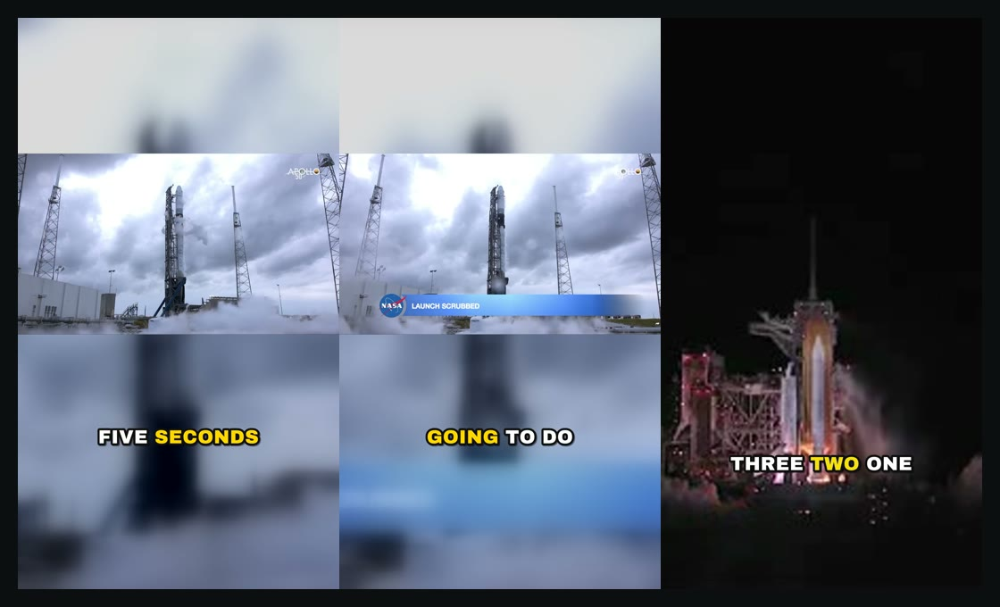
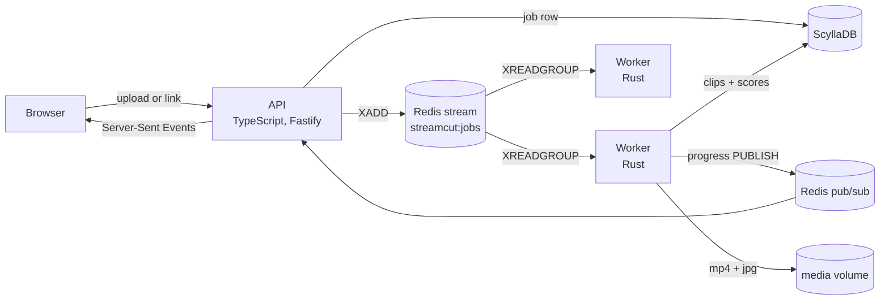

# Streamcut

Long video in, short clips out.

You give Streamcut a stream recording (upload or link). It finds the moments worth sharing, cuts them to vertical 9:16, adds word-by-word captions, and tells you why it picked each one.



*Three clips it made from NASA launch broadcasts (public domain): the T-5 seconds call before a launch was called off, the "launch scrubbed" moment, and a Space Shuttle liftoff.*

I built it to show how I would put together the backend for an AI clips product: a TypeScript API, a Rust worker that does the heavy video work, Redis for the job queue and live progress, and ScyllaDB for jobs and clips. Everything runs with Docker Compose or on Kubernetes.

## What it does on real video

I tested it on two NASA broadcasts, on a MacBook (M2 Pro):

| Video | Length | Clips | Time | Clip #1 |
|---|---|---|---|---|
| SpaceX cargo launch, called off for weather | 26 min | 5 | 56 s | "The launch is a no-go for today", the T-5 s hold |
| Space Shuttle STS-131 launch | 10 min | 3 | 20 s | "Three, two, one, zero, booster ignition and liftoff of Discovery" |

The SpaceX one is a good test because nothing loud happens: the rocket never leaves. The best moments are about what people say, so loudness alone would miss them.

In Docker the worker has no GPU and uses the CPU encoder (libx264). The same shuttle video took 51 s there instead of 20 s, almost all of it speech to text on 4 CPU threads. On a Mac the worker can use the hardware encoder and Metal, which is why I also run it outside Docker there.

## How it works



1. The **API** checks the request, saves the job in ScyllaDB and puts its id on a Redis stream.
2. A **worker** takes the job and runs the pipeline:
   - `ffprobe` reads the file, `ffmpeg` pulls the sound out as 16 kHz mono.
   - **whisper.cpp** writes down every word with its time. At the same time, ffmpeg looks for camera changes.
   - The worker scores every second of the video (next section), picks the clips and moves their edges to sentence breaks so no one is cut off mid-word.
   - ffmpeg cuts each clip to 1080×1920, burns in the captions and evens out the sound (-14 LUFS, the level social apps use).
3. While it works, the worker publishes progress on Redis. The API passes it to the browser as Server-Sent Events, so the page updates live.
4. The clips, their scores and the chart data go into ScyllaDB. The files go in the shared media folder.

## How it picks the moments

Every second gets four numbers, each measured against the rest of *this* video, so a quiet podcast and a loud esports stream are both judged fairly:

| Signal | What it measures |
|---|---|
| Loudness | How far the sound jumps above the minute around it (crowds, shouting, engines) |
| Talking speed | Words per second compared with the speaker's usual pace |
| Key words | Phrases that usually mark a moment ("no way", "let's go", "we have liftoff") and sounds whisper hears, like [APPLAUSE] or [LAUGHTER] |
| Camera changes | Lots of cuts in a short time (replays, switching angles) |

They are added up into one score per second. Then I pick clips the way an editor would: find the busiest second, grow outwards while the action stays above 40% of that peak, add 6 seconds of build-up before it and 3 after, fit it to the length you asked for, and repeat with what is left. Clips never overlap.

Each clip comes with plain reasons, for example:

```
#2  The launch is a no-go for today
    - Sound jumps 22 dB above the minute around it
    - Key words: "no-go", "abort", "scrubbed"
```

The job page draws the score over the whole video and shades the clips it picked, so you can see why it chose them.

**Where it gets it wrong:** key words are matched by text, so they cannot tell "we have liftoff!" from "liftoff is at 6:24". On the SpaceX video, clip #1 is a calm sentence about the launch time that scored high because of the word "lift off" and some camera changes. A small language model reading the transcript around each candidate would fix this. That is the first thing I would add (see "What I would do next").

## When things go wrong

I care most about this part, because video jobs are long and machines die.

| What happens | What Streamcut does | Tested |
|---|---|---|
| A worker is killed mid-job (crash, out of memory, node lost) | The job stays "pending" in the Redis consumer group. Workers touch their job every few seconds. When a job sits untouched for 90 s, another worker takes it over with `XAUTOCLAIM`. | Yes. I killed a worker with `kill -9` while it was transcribing. A second worker took the job over and finished it ("finished on try 2"). |
| A worker is stopped normally (deploy, scale down) | On SIGTERM it stops ffmpeg/whisper, puts the job back on the queue at once and exits. No waiting for the idle timer, and it does not count as a failed try. | Yes. The job was back in the queue 3 ms after the signal and the next worker finished it on try 1. |
| A job keeps failing | Redis counts deliveries. After 3 tries the job moves to a dead letter stream (`streamcut:jobs:dead`) and is marked failed, instead of looping forever. | Not yet: the code is there, but I have not forced three failures in a row. |
| The input is broken (not a video, 404 link, private address) | Marked as a permanent error: the job fails straight away with a clear message. No pointless retries. | Yes |
| The other side is busy (HTTP 429 or 5xx while downloading) | Treated as temporary, so the job is retried. | Yes. Wikimedia answered 429. My first version failed the job for good; I changed it to retry and it went through. |
| ffmpeg or whisper hangs | Every child process has a time limit and is killed if it runs over. | Yes, by design. A job that hangs with no limit can stall a queue for hours. |
| The same job is delivered twice | The worker checks the job's status first and skips work that is already done. Saving clips deletes old ones first, so a retried job never shows a mix. | Not yet as its own test |
| The browser sends the same request twice | Send an `Idempotency-Key` header and you get the same job back, not a second one. | Yes |
| Redis is down when a job is created | The API marks the job failed and answers 503, so the client knows to retry. | Yes |

## Data

**ScyllaDB.** Each table is shaped around one question the app asks, so every read hits one partition and nothing needs `ALLOW FILTERING`. See [db/schema.cql](db/schema.cql).

| Table | Partition key | Answers |
|---|---|---|
| `jobs` | `job_id` | "Show me this job" |
| `jobs_by_day` | `day` (clustered by `created_at DESC`) | "Show the latest jobs". Partitions stay small; old days are just not read. |
| `clips_by_job` | `job_id` (clustered by `rank`) | "Show this job's clips, best first" |
| `signals_by_job` | `job_id` | The chart. Stored as frozen lists, one cell each instead of 1,500. |

**Redis.**

| Key | Type | Use |
|---|---|---|
| `streamcut:jobs` | stream + consumer group `workers` | The job queue |
| `streamcut:jobs:dead` | stream | Jobs that failed every try |
| `streamcut:progress:<job>` | pub/sub channel | Live progress |
| `streamcut:idem:<sha256>` | string, 24 h | Idempotency keys |
| `streamcut:rate:<ip>:<minute>` | counter | 20 new jobs a minute per client |

Each API process subscribes to a job's channel only once, however many browsers are watching it.

## Safety

- **Pasted links:** only http and https. The worker looks up the host and refuses private and internal addresses (so a link cannot reach `169.254.169.254` or the internal network), connects to the exact address it checked, follows redirects one at a time and checks each one, and stops at 2 GB. The API also rejects obvious cases straight away, including the sneaky `[::ffff:7f00:1]` form of 127.0.0.1.
- **Files:** paths from the database are checked to stay inside the data folder before anything is served.
- **Uploads:** size limit, streamed to disk (never held in memory), deleted if the request fails.
- Both containers run as a normal user, not root.

## API

| Method | Path | |
|---|---|---|
| `POST` | `/v1/jobs` | Start a job. JSON `{ "url": "...", "settings": {...} }` or a multipart upload with a `file` field. Optional `Idempotency-Key` header. Returns `202` and the job. |
| `GET` | `/v1/jobs` | Latest jobs (`?limit=20`) |
| `GET` | `/v1/jobs/:id` | The job, its clips (best first) and the chart data |
| `GET` | `/v1/jobs/:id/events` | Live progress (Server-Sent Events). Closes when the job is done. |
| `GET` | `/v1/jobs/:id/clips/:rank/video` | The clip (mp4, supports `Range` so players can seek). Add `?download` to save it. |
| `GET` | `/v1/jobs/:id/clips/:rank/thumb` | Thumbnail |
| `POST` | `/v1/jobs/:id/retry` | Try a failed job again |
| `GET` | `/v1/queue` | Jobs waiting and in progress, and each worker |
| `GET` | `/healthz`, `/readyz` | Liveness, and readiness (checks Redis and ScyllaDB) |

Settings: `clips` (1–10, default 5), `minLen` / `maxLen` in seconds (default 20–60), `layout` (`blur`: whole picture with a blurred background, or `crop`: centre crop), `captions` (default on).

```bash
curl -X POST localhost:8080/v1/jobs -H 'Idempotency-Key: my-first-job' \
  -F clips=3 -F layout=blur -F file=@my-stream.mp4
```

## Run it

**Everything in Docker** (open http://localhost:8080):

```bash
docker compose up -d --build
```

Add workers with `docker compose up -d --scale worker=3`.

**On your machine, with only Redis and ScyllaDB in Docker** (faster on a Mac):

```bash
docker compose -f docker-compose.yml -f docker-compose.hostdev.yml up -d redis scylla
cd api && npm ci && npm run dev
cd worker && cargo run --release
```

The worker needs `ffmpeg` (with libass for captions; on a Mac that is `brew install ffmpeg-full`), and `whisper-cli` with a model at `~/.cache/streamcut/ggml-base.en.bin`. Without a model it still works, using sound and camera changes only.

**One file, no queue or database:**

```bash
cd worker && cargo run --release -- local my-stream.mp4 --clips 5 --out ./out
```

**Kubernetes (kind):** `deploy/kind.sh` builds the images, loads them into a kind cluster and applies [deploy/k8s](deploy/k8s). There is also an optional KEDA scaler that adds workers when jobs wait in the queue.

## Tests

- **Rust worker:** 39 unit tests (WAV reading, loudness, silence, transcript parsing, phrase matching, scoring, clip picking, sentence snapping, captions, ffmpeg filters, the address checks). `cargo test`
- **API:** 33 tests with in-memory stand-ins for Redis and ScyllaDB (uploads, links, blocked addresses, settings, idempotency, rate limit, queue down, range requests, path escapes, retry, live progress). `npm test`
- **End to end:** [scripts/e2e.sh](scripts/e2e.sh) makes a 90 s test video that is quiet except for a loud burst at 40–46 s, sends it through the whole stack and checks that clip #1 covers the burst.

CI runs all three on every push, including the whole stack in Docker Compose.

## What I would do next

1. **Smarter ranking with a language model.** Send the transcript around each top candidate to a small model and ask: is this a moment? What is a good title? Keep the signal scores as the first pass, so the model only reads a few short pieces, which keeps it fast and cheap.
2. **Object storage** (S3 or R2) for uploads and clips instead of a shared folder. The worker would download its part, upload the clips, and the API would hand out signed links. Then the shared volume goes away and workers can run anywhere.
3. **Face tracking for the crop.** The centre crop loses people standing to one side. Track faces per shot and move the crop with them, smoothly.
4. **Resume from the last finished step.** A retried job starts from the beginning. Saving the transcript after the first try would make retries much faster.
5. **Live streams.** Score the stream in 10-minute chunks while it runs, so clips are ready minutes after something happens, not after the stream ends.
6. **More languages.** whisper supports them; the key word list would need translating, or the language model step would replace it.

## Project layout

```
api/        TypeScript API (Fastify, Zod, cassandra-driver, ioredis)
worker/     Rust worker (tokio, scylla, redis); ffmpeg + whisper.cpp do the media work
web/        The page: plain HTML, CSS and JavaScript, no build step
db/         ScyllaDB schema
deploy/     Kubernetes manifests, kind script, KEDA scaler
scripts/    End-to-end test
fonts/      Archivo Black for the captions (SIL Open Font License)
```

Test videos are NASA footage from Wikimedia Commons (public domain) and are not in the repo.
